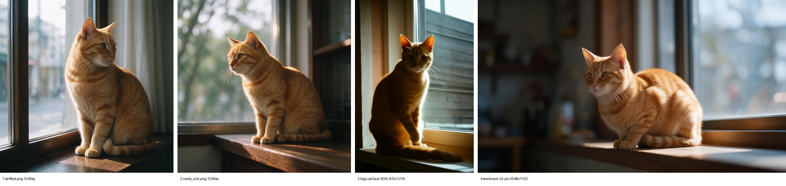

# Ark nodes for ComfyUI · 火山方舟 Seedream / Seedance

把火山方舟（Volcengine Ark）的 **Seedream 图像生成**与 **Seedance 视频生成**接口做成 ComfyUI 原生节点。

纯 REST 实现，不依赖官方 SDK：图片走 `POST /api/v3/images/generations`，视频走异步任务 `POST /api/v3/contents/generations/tasks` + 轮询。节点输出是 ComfyUI 原生 `IMAGE` / `VIDEO` 类型，能直接接 `SaveImage` / `SaveVideo`。

写它的原因很具体：我要的几个控制项在现成节点上没有 —— 按**计费像素台阶**设计的尺寸档、原生多图参考槽位、5.x 与 4.x 的组图行为差异、视频的异步轮询与**尾帧续接**。



---

## 节点

| 节点 | 分类路径 | 关键输入 | 输出 |
|---|---|---|---|
| `ArkSeedreamImage` | 火山方舟/Seedream | prompt、model、size_preset、max_images、seed、watermark、`image1~4`（可选参考图） | `images`（IMAGE 批）、`info`（模型/尺寸/张数/耗时/request_id） |
| `ArkSeedanceVideo` | 火山方舟/Seedance | prompt、model、mode（4 种）、resolution、ratio、duration、generate_audio、`image_first` / `image_last` / `ref_image1~3` | `video`（VIDEO）、`info`、`last_frame`（IMAGE，喂给下一段的首帧） |

## 安装

```bash
git clone <this-repo> ComfyUI/custom_nodes/ComfyUI-VolcengineArk
```

依赖：`requests`、`numpy`、`torch`、`Pillow`（ComfyUI 环境自带）；`av`（PyAV）只在取视频尾帧时用到，拿不到尾帧不影响主输出。重启 ComfyUI 后节点出现在右键菜单 **火山方舟** 分类下。

## API Key

按顺序查找，命中即用：

1. 环境变量 `ARK_API_KEY`
2. 节点目录下的 `api_key.txt`（一行 key，不带引号）
3. `%LOCALAPPDATA%\hermes\.env` 里的 `ARK_API_KEY`

节点上另有 `api_key_override` 输入口，用于临时换 key。仓库内不含任何凭据，`api_key.txt` 与 `.env` 已在 `.gitignore` 中。

---

## 成本控制是设计的一部分

**图像按像素台阶计费。** Seedream 5.0 pro 单张上限 2.61MP，超过就按 **2 张**收费。所以 2K 正方形档不能用 2048×2048（4.19MP，直接翻倍），节点里给的是 **1600×1600（2.56MP）**。横向场景用 `2048×1152（2.36MP）`，单价不变还更大。

**视频按时长 × 分辨率计费**（Seedance 2.5，5 秒、不含输入视频，实测价）：

| 分辨率 | 一条 5 秒 | 每秒 |
|---|---|---|
| 480p | 3.36 元 | 0.67 元 |
| 720p | 7.56 元 | 1.51 元 |
| 1080p | 18.71 元 | 3.74 元 |

工作方式是**先 480p 探路**：构图和动势对了再上 720p，同一个提示词重跑换结果是常态，先在便宜档筛掉废片。

---

## 三个非显然的实现点

**1. 5.0 系列没有原生组图。** `sequential_image_generation` 是 seedream-4.x 的参数，5.x 传了不生效。所以 `max_images > 1` 时节点内部循环发 N 次请求，并把 `seed` 递增为 `seed + i` —— 否则多次请求在服务端看来完全一样。4.x 仍走一次请求出全组。

**2. 视频是异步任务，节点必须自己轮询。** 提交拿到 `id` 后每 5 秒查一次状态，`succeeded` 才取 `video_url` 下载；`failed / expired / cancelled` 立即抛错并带上服务端返回体；超时保留 task id 供去控制台查。

**3. 尾帧是下一段的输入。** `last_frame` 用 PyAV 解出最后一帧转 IMAGE，直接接到下一段的 `image_first` 就是分段续接 —— 2.0 单段最多 15 秒，靠这个串成 30 秒。拿不到尾帧时不阻断主输出，返回一张占位 tensor。

## 踩过的坑

- **`ratio=adaptive` 不能混用。** 第二段填 adaptive 时模型不会跟随首帧，会自己给一个 640×640，和第一段的 864×496 对不上，`ConcatenateVideo` 直接报 `incompatible frame dimensions`。两段必须显式填同一个 ratio 和分辨率。
- **模型 id 不能省版本后缀。** `doubao-seedream-5-0-flash` 会 404，必须写全 `-260915`。
- **seedance 1.0 系列在本机账号上返回 NotFound**（未开通或已下线），所以下拉框默认只列 2.x，需要别的 id 用 `custom_model` 覆盖。

---

## 工作流

| 文件 | 内容 |
|---|---|
| `workflows/seedream-t2i.json` | 最简文生图（2 节点） |
| `workflows/local-sdxl-biglust.json` | 本地 SDXL 对照（bigLust_v16，832×1216 / seed 12345 / 30 steps / cfg 7） |
| `workflows/character-three-view.json` | 角色三视图，`max_images=2` 出写实 + 动漫两版 |
| `workflows/seedance-t2v.json` | 最简文生视频（480p / 16:9 / 5s） |
| `workflows/seedance-2seg-chain.json` | 两段接续：第 1 段 `last_frame` → 第 2 段 `image_first` |

## 样例

| 文件 | 说明 |
|---|---|
| `samples/seedream-flash-1536-a.png` / `-b.png` | Seedream flash，1536²，同提示词两次结果 |
| `samples/seedream-pro-2k-2048x1152.png` | Seedream pro，2048×1152，毛发与暗部层次明显更完整 |
| `samples/local-sdxl-biglust-832x1216.png` | 本地 SDXL bigLust，分辨率低、对比度更强、背景简化 |
| `samples/character/three-view-*.png` | 同一角色的写实版与动漫版三视图，`max_images=2` 一次产出 |
| `videos/seedance-t2v-480p.mp4` | 480p / 16:9 / 5s 成品：854×480、24fps、121 帧、2.78MB、约 2 分钟出片 |

## 已知限制

- 没有并发控制和请求队列，一次多张是串行循环。
- 轮询间隔固定 5 秒，没有指数退避；也没有对网络错误的自动重试。
- 参考图转成 base64 data URI 放在请求体里，大图会明显增大上传体积。
- 只在 Windows + ComfyUI Desktop 上验证过，macOS / Linux 未测。
- 没有单元测试；节点只在真实账号下做过端到端验证。

## License

未指定（UNLICENSED）。接口属于火山引擎，使用时请遵守其服务条款。
